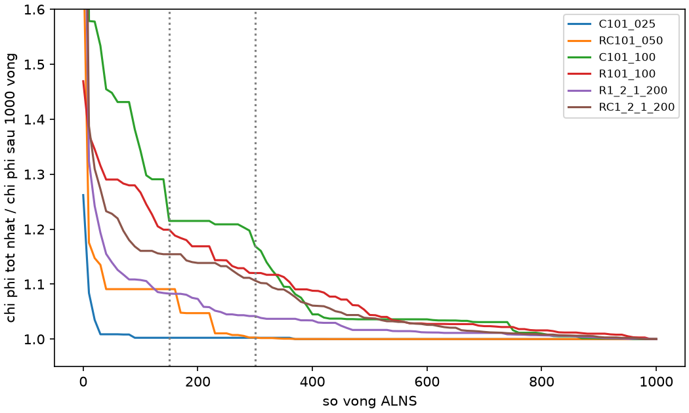

# Tinh chinh ALNS (T23)

Giai bai toan tinh luc t = 0, toan bo khach, 4 seed, toan tu day du (FULL_CFG). Chi phi la trung binh cua chi phi tot nhat tai moi moc vong lap.

| Instance | n | Vong | Chi phi TB | Cach chi phi sau 1000 vong (%) | Thoi gian uoc tinh (s) |
|---|---|---|---|---|---|
| C101_025 | 25 | 100 | 715.0 | 0.24 | 0.22 |
| C101_025 | 25 | 250 | 715.0 | 0.24 | 0.54 |
| C101_025 | 25 | 500 | 713.3 | 0.0 | 1.09 |
| C101_025 | 25 | 1000 | 713.3 | 0.0 | 2.17 |
| RC101_050 | 50 | 100 | 1445.5 | 9.09 | 0.62 |
| RC101_050 | 50 | 250 | 1338.9 | 1.04 | 1.55 |
| RC101_050 | 50 | 500 | 1325.1 | 0.0 | 3.1 |
| RC101_050 | 50 | 1000 | 1325.1 | 0.0 | 6.2 |
| C101_100 | 100 | 100 | 4132.8 | 34.25 | 3.51 |
| C101_100 | 100 | 250 | 3721.2 | 20.88 | 8.76 |
| C101_100 | 100 | 500 | 3189.3 | 3.6 | 17.53 |
| C101_100 | 100 | 1000 | 3078.5 | 0.0 | 35.05 |
| R101_100 | 100 | 100 | 7165.9 | 26.66 | 3.11 |
| R101_100 | 100 | 250 | 6467.9 | 14.32 | 7.78 |
| R101_100 | 100 | 500 | 5905.7 | 4.39 | 15.57 |
| R101_100 | 100 | 1000 | 5657.5 | 0.0 | 31.14 |
| R1_2_1_200 | 200 | 100 | 5948.1 | 10.75 | 4.64 |
| R1_2_1_200 | 200 | 250 | 5612.1 | 4.5 | 11.59 |
| R1_2_1_200 | 200 | 500 | 5459.9 | 1.66 | 23.18 |
| R1_2_1_200 | 200 | 1000 | 5370.6 | 0.0 | 46.35 |
| RC1_2_1_200 | 200 | 100 | 5087.2 | 16.05 | 5.09 |
| RC1_2_1_200 | 200 | 250 | 4965.5 | 13.27 | 12.71 |
| RC1_2_1_200 | 200 | 500 | 4550.2 | 3.8 | 25.43 |
| RC1_2_1_200 | 200 | 1000 | 4383.8 | 0.0 | 50.85 |

## Nhan xet (chay lai 17/11/2026 tren du lieu that)

So vong dang dung moi lan giai trong `config.yaml` (150 / 250 / 400 / 600 cho n = 25 / 50 / 100 / 200), doi chieu bang tren:

- n = 25: 150 vong da gan hoi tu (cach 1000 vong khoang 0,2%).
- n = 50: 250 vong cach 1000 vong khoang 1%.
- n = 100: 400 vong nam giua moc 250 (14-21%) va 500 (3,6-4,4%), la ngan sach yeu nhat. Neu du thoi gian nen tang len 500.
- n = 200: 600 vong nam giua moc 500 (1,7-3,8%) va 1000.

Day la bai toan TINH giai tu dau; trong ALNS dong, warm-start va nhieu lan giai lien tiep bu bot cho ngan sach moi lan.
Thoi gian o day cham hon lan chay cu khoang 6-7 lan do khac may (ban cu do tren may 2 nhan); xu huong theo so vong van tuyen tinh.
